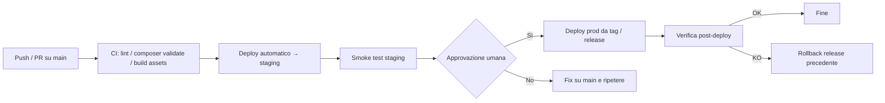
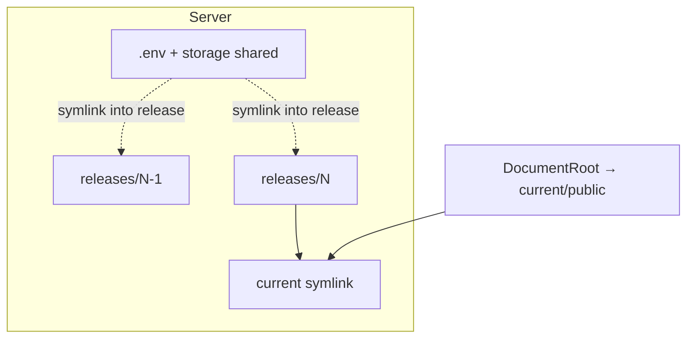
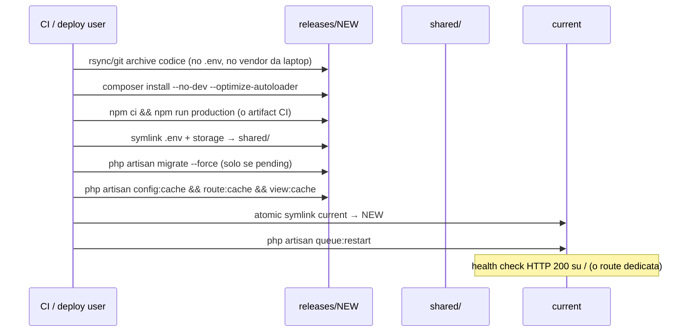
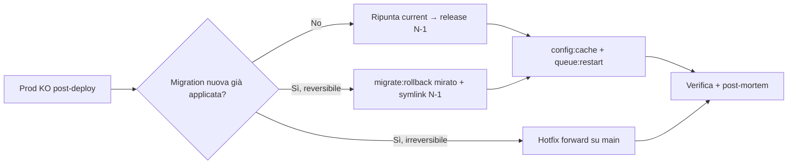

# QB — Disegno deploy

**Stato:** disegno (carta). Script e Actions: step successivo.  
**Ticket:** **KAN-28** — Disegnare e automatizzare il deploy QB.  
**Ambienti:** staging `157.230.99.252` · prod `qb.golinucci.it` / `46.101.103.49` · PHP 8.1 · Apache.

---

## 1. Flusso di promozione



| Passo | Chi | Cosa |
|-------|-----|------|
| Merge su `main` | Dev | Unica branch di integrazione |
| Deploy staging | CI (automatico) | Ogni push su `main` (o workflow `workflow_dispatch`) |
| Approvazione | Tech lead / Golinucci | Environment protection GitHub su `production` **oppure** conferma esplicita prima del job prod |
| Deploy prod | CI (gated) | Solo da **tag** `vX.Y.Z` (o release GitHub) già verificata su staging |
| Rollback | Ops / CI | Ripunta symlink `current` alla release precedente |

**Regola:** prod non si deploya da commit “sporchi”: solo da tag che punta a un SHA già passato da staging.

---

## 2. Layout sul server (releases + symlink)

Stesso schema su staging e prod (path diversi).

```text
/var/www/qb/                    # o path concordato con Vittorio
├── releases/
│   ├── 20261005_101200_a1b2c3d/
│   ├── 20261005_143000_e4f5g6h/   ← attuale
│   └── ...
├── shared/
│   ├── .env
│   ├── storage/                 # logs, uploads, private Lloyd’s, ecc.
│   └── bootstrap/cache/         # opzionale se si preferisce shared
└── current → releases/20261005_143000_e4f5g6h/
```

Apache/Nginx punta a `current/public`.



**Rollback:** `ln -sfn releases/<precedente> current` + `php artisan config:cache` (e opz. `queue:restart`) — **senza** ri-eseguire migrate “in avanti”. Se una migration era già andata in prod, il rollback codice va accompagnato da piano DB (migration down solo se sicura; altrimenti hotfix forward).

---

## 3. Cosa deployare (passi atomici)

Ordine consigliato dentro ogni nuova cartella `releases/<id>`:



| Step | Comando / azione | Note |
|------|------------------|------|
| Codice | artifact o `git archive` / rsync esclusi | No `.env`, no `node_modules` da laptop |
| PHP deps | `composer install --no-dev --optimize-autoloader` | PHP 8.1 + ext sul server |
| Assets | build in CI, upload `public/mix-manifest.json` + `public/js|css` | Evita Node pesante in prod se possibile |
| Shared | `ln -s` `.env`, `storage` | Mai sovrascrivere `.env` prod |
| Migrate | `php artisan migrate --force` | Solo se ci sono migration nuove; in pre-prod: backup prima |
| Cache | `config:cache`, `route:cache`, `view:cache` | Dopo symlink o subito prima; coerente con `.env` linked |
| Coda | `php artisan queue:restart` | Supervisor deve riprendere i worker |
| Cleanup | tenere N release (es. 5), cancellare le più vecchie | |

**Non deployare:** `vendor` dal laptop, file tinker one-shot, `.env`, dump DB, chiavi SSH.

---

## 4. Checklist pre-prod

Da spuntare **prima** dell’approvazione al deploy prod (anche a mano finché non è in CI).

### Obbligatorie

- [ ] SHA/tag da pubblicare = quello già su **staging** e smoke OK
- [ ] **Backup DB** prod (snapshot Managed MySQL DigitalOcean o `mysqldump` cifrato)
- [ ] Elenco migration in arrivo rivisto (`php artisan migrate:status` su staging)
- [ ] Nessun secret nuovo dimenticato in `.env` prod (confronta chiavi con `.env.example`)
- [ ] Approvazione umana registrata (GitHub environment / commento Jira / chat)

### Consigliate

- [ ] `php artisan down` (maintenance) se migrate lunghe o breaking UX — altrimenti deploy a caldo con symlink atomico
- [ ] Congelare deploy paralleli (un solo deploy alla volta)
- [ ] Avvisare ops (Paolo/Margherita) se finestra su orari rinnovi/pagamenti
- [ ] Piano rollback dichiarato (release precedente nota)

### Post-deploy (entro 15 min)

- [ ] Home / login / un flusso buy o backoffice smoke
- [ ] Log Laravel senza boom (`storage/logs`)
- [ ] Worker coda vivi (`supervisorctl status`)
- [ ] Webhook Yousign / return PayPal non 5xx (se toccati)

---

## 5. Rollback



1. Annotare release rotta e precedente (`readlink current`).
2. Backup DB già fatto in pre-prod: non ripristinare DB a meno di corruzione dati.
3. Symlink indietro + cache + `queue:restart`.
4. Se serve restore DB: solo da backup pre-deploy, con ok esplicito.

---

## 6. Mapping CI (da implementare dopo)

| Trigger | Job |
|---------|-----|
| Push `main` | test leggeri + deploy **staging** |
| Tag `v*` / Release pubblicata | deploy **prod** (environment `production` con reviewer) |
| `workflow_dispatch` | deploy manuale ambiente scelto |

**Segreti GitHub (indicativi):** host SSH staging/prod, utente deploy, chiave, path app. `.env` resta solo sul server in `shared/`.

**Accesso:** whitelist IP (Vittorio) — runner GitHub hosted può richiedere IP allowlist o self-hosted runner / jump via macchina già whitelisted. Da chiudere con Bitmark prima di automatizzare.

---

## 7. Fuori scope di questo disegno

- qb1 / firma / GolSign (stack PHP diversi) — deploy separato se mai toccati
- Sync DB staging ← prod (refresh dati): procedura a parte, non nel deploy app
- Stripe / Redis: quando arrivano, solo variabili `.env` + eventuale service Supervisor

---

## 8. Script locale (KAN-28 — bozza)

Presente in repo:

```bash
cp deploy/env/staging.env.example deploy/env/staging.env   # valori da Vittorio
./deploy/deploy.sh staging --dry-run
./deploy/deploy.sh staging
./deploy/deploy.sh prod --rollback
```

Ancora da chiudere con Bitmark: path reale, utente SSH, whitelist IP runner, workflow Actions.
